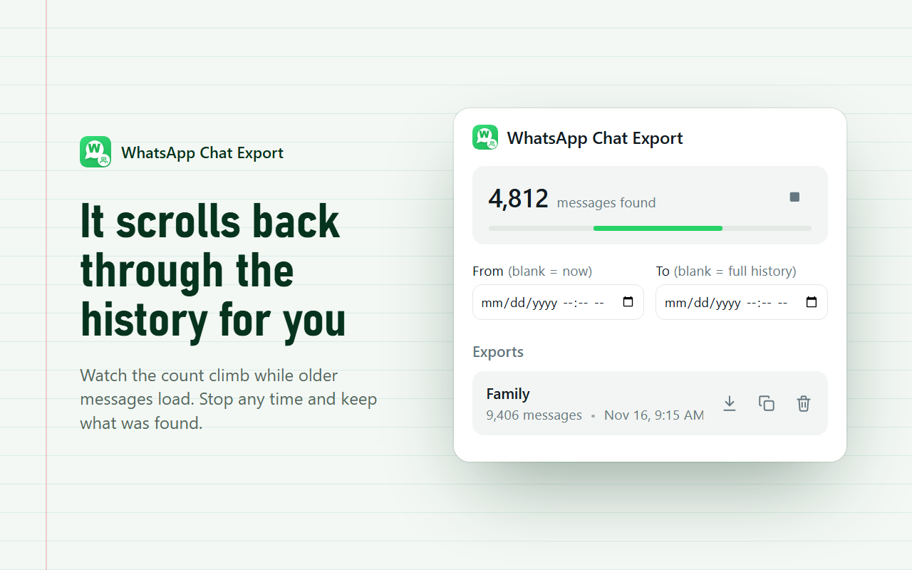
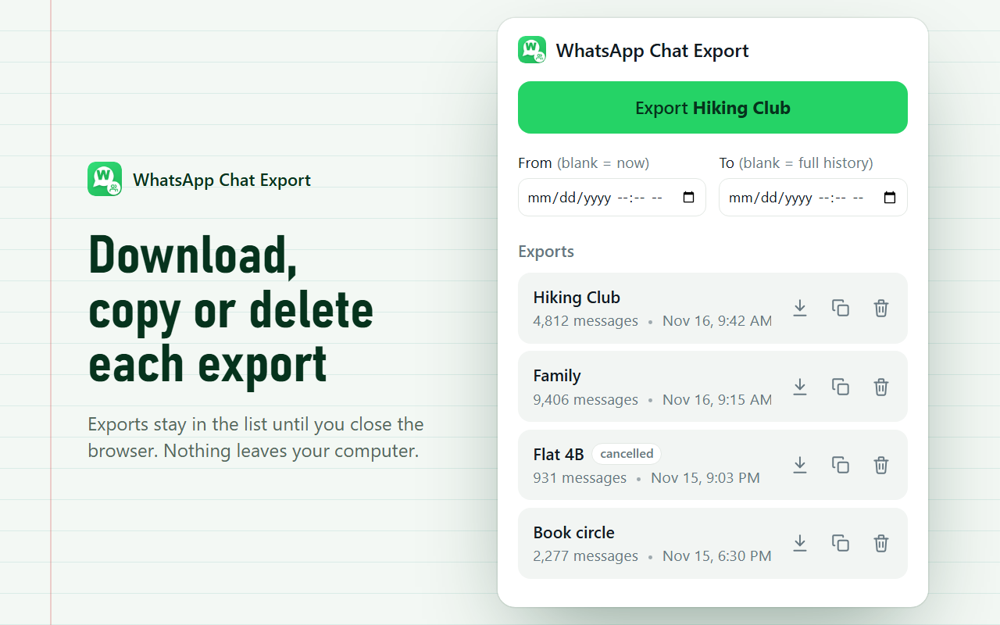
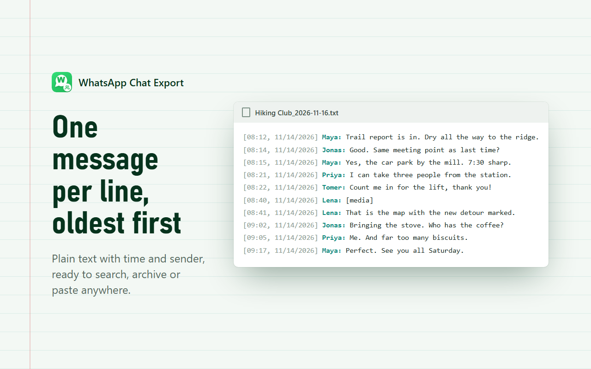

<p align="center"></p>

# WhatsApp Chat Export

Chrome extension that exports the message history of a WhatsApp Web chat to a plain text file. Free, no message limit, and nothing leaves your computer.


## Install

Install it from the Chrome Web Store: search for **WhatsApp Chat Export - Download Easy, Private, No Limits**.

## Screenshots

| | |
| --- | --- |
|  |  |
|  |  |

## Use

1. Open a chat on [web.whatsapp.com](https://web.whatsapp.com)
2. Click the extension icon
3. (Optional) Set a From and/or To date to limit the export to a range — leave blank for "now" / "full history"; with both set, either order works
4. Click **Export**
5. Download, copy, or delete the export from the list once it finishes

### How it knows it's done

WhatsApp loads older history in batches, and a batch can take a long time to arrive (longer still when it comes from your phone). The export therefore keeps scrolling up until the chat has produced nothing new for a full minute (three minutes while WhatsApp's "get older messages from your phone" prompt is showing), then saves. Messages that arrive while it runs are included but do not keep it waiting. Expect every export to end with that one-minute pause, during which the counter simply stops moving. Press the stop button to finish early with what has been gathered so far.

One export runs at a time. The popup shows its progress and stop button whichever tab you open it on.

Keep the WhatsApp tab visible while it runs. A hidden tab doesn't render, so WhatsApp can't load anything; the export waits rather than giving up, and the popup says so.

An export too large for the popup's list (roughly 10MB of text) is saved straight to your Downloads folder instead.

## Permissions

- `storage` — holds exports and export progress in `chrome.storage.session`, which clears itself on browser restart (that's the entire "reset every restart" behavior, no extra code needed).
- `downloads` — saves an export as a `.txt` file when you click Download.
- `activeTab` — lets the popup read the active tab's URL when you open it, to enable/disable the Export button.
- Content-script access to `web.whatsapp.com` — reads the open chat's messages on that page only; nothing is sent anywhere off your machine.

## Privacy

See [PRIVACY.md](PRIVACY.md). The extension makes no network requests.

## Develop

```
npm test
```

To run a local copy, load this folder with **Load unpacked** on `chrome://extensions`.

## Project layout

- `src/content/` — runs in the WhatsApp Web tab. `content.js` is a stub that loads `main.js`; `chatPage.js` holds everything that depends on WhatsApp's markup; `exportChat.js` is the scroll-and-collect loop; the rest are pure helpers.
- `src/popup/` — the extension's popup UI
- `src/shared/` — used by both: `exportStore.js` (what is kept in `chrome.storage.session`), `messages.js` (popup ↔ tab messages), `format.js`
