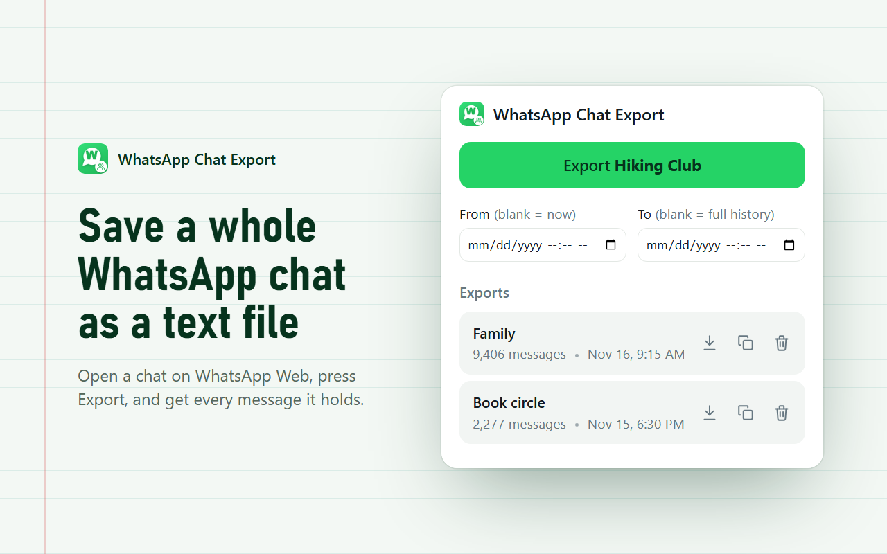
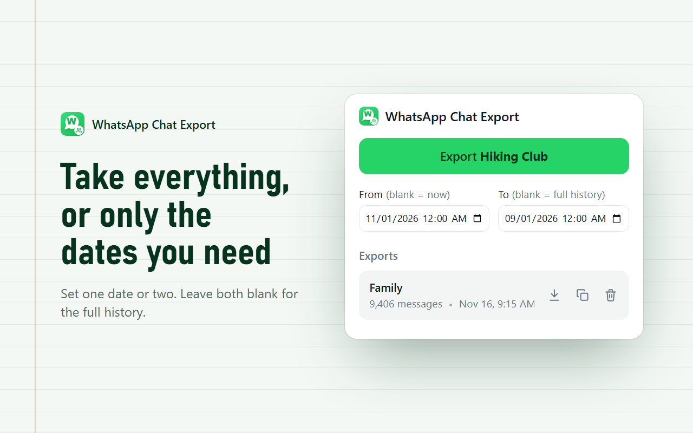

# WhatsApp Chat Export

Chrome extension that saves any WhatsApp Web chat as a text file. Free, no message limit, and nothing leaves your computer.

## Install

Install it from the Chrome Web Store: search for **WhatsApp Chat Export - Download Easy, Private, No Limits**.

## Use

1. Open a chat on [web.whatsapp.com](https://web.whatsapp.com)
2. Click the extension icon
3. Optional: set a From and To date to export only part of the chat
4. Click **Export**
5. Download, copy or delete the export when it finishes

Keep the WhatsApp tab visible while it runs. An export ends about a minute after the last message loads; press stop to finish sooner with what was found.

## Screenshots

| | |
| --- | --- |
|  |  |
|  |  |

## Privacy

Everything happens in your browser. No network requests, no tracking. See [PRIVACY.md](PRIVACY.md).
